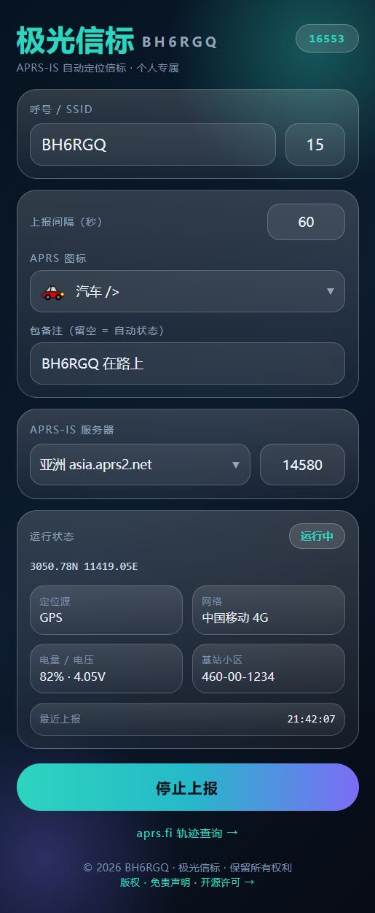
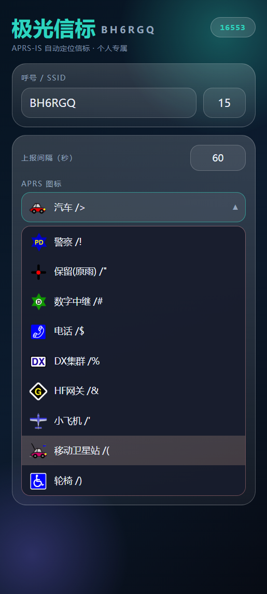
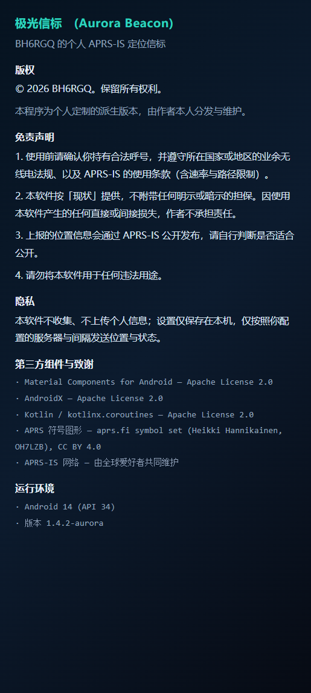

# 极光信标 · Aurora Beacon

> 把手机变成一台 APRS-IS 定位信标：按设定间隔自动把位置打进 APRS-IS，别人在 [aprs.fi](https://aprs.fi) 上就能看到你。

<!-- 仓库：https://github.com/Honest16888/aurora-beacon -->


---

## 目录

- [这是什么](#这是什么)
- [特性](#特性)
- [截图](#截图)
- [快速开始](#快速开始)
- [界面说明](#界面说明)
- [APRS 报文长什么样](#aprs-报文长什么样)
- [权限说明](#权限说明)
- [仓库结构](#仓库结构)
- [从源码构建](#从源码构建)
- [已知限制](#已知限制)
- [路线图](#路线图)
- [常见问题](#常见问题)
- [贡献](#贡献)
- [许可与致谢](#许可与致谢)

---

## 这是什么

**极光信标（Aurora Beacon）** 是一个 Android 端的 APRS-IS 自动定位信标。它把手机当前位置按固定间隔封装成标准 APRS 位置报文，通过 TCP 直连 APRS-IS 网络上报，所以在 aprs.fi、APRSdroid 之类的任何客户端里都能看到你的轨迹。

它不是地图软件，也不做社交：只做一件事——**定时把"我在哪"发出去**。适合车载、徒步、骑行、应急通信演练等场景，也适合当作一个可读、可改的 APRS 客户端参考实现。

技术形态比较特别，先说清楚：本工程是一个 **apktool 逆向改造工程 + Java 模块（打进 `classes2.dex`）** 的混合体，不是标准的 Gradle 工程。为什么这么干、怎么构建，见 [docs/ARCHITECTURE.md](docs/ARCHITECTURE.md) 和 [docs/BUILD.md](docs/BUILD.md)。

## 特性

### 上报

- 标准 APRS-IS 位置报文，`CALL-SSID>APRS,TCPIP*:!` 非压缩格式
- APRS 密码自动计算（呼号一改立即重算，点一下复制）
- 上报间隔 5–3600 秒可调，默认 60 秒
- 服务器可选：`rotate / asia / euro / noam / oceania .aprs2.net`，端口默认 14580
- 报文备注可自定义（留空则自动填 `AURORA 定位源 网络 电量`）
- 前台服务 + WakeLock，锁屏后继续上报

### 图标

- **188 个官方 APRS 符号**（主表 94 + 副表 94，ASCII `0x21–0x7E`），下拉列表里图标 + 文字一起显示
- 符号图形来自 aprs.fi 高清符号集（CC BY 4.0），已重采样为 64×64，`drawable-nodpi`

### 状态与信息

- 运行状态胶囊 + 2×2 磁贴：定位源、网络、电量/电压、基站小区、最近上报时间
- 网络制式识别（2G/3G/4G/5G + 运营商），取不到时降级为"蜂窝"而不是"未知"
- **APRS 消息（发送）**：填收件呼号 + 内容，按标准 `::ADDRESSEE :text{NN` 发出（只发不收）
- **一键地图**：按最近上报坐标打开系统地图，没有地图 App 时自动退到 OpenStreetMap
- 底部版权页：版权、免责声明、隐私说明、第三方组件、运行环境

### 界面

- 深色极光渐变 + 磨砂玻璃卡片（22dp 圆角、半透明白、1dp 高光描边、零阴影）
- 全部纯 XML drawable 实现，`minSdk 26` 也能出效果，不依赖 API 31 的 `RenderEffect`
- 单页滚动布局，无 ActionBar

### 稳定性

- 自定义图标适配器由 `javac` + `d8` 编译（编译器逐条核对 Android API，避免手写字节码的方法归属错误）
- 全链路 try-catch 降级：取不到图标就只显示文字，取不到制式就显示"蜂窝"，**不闪退**
- `CrashGuard`：未捕获异常自动写堆栈到
  `/sdcard/Android/data/com.yg.aprs/files/crash.txt`

## 截图

| 主界面 | 图标选择 | 版权页 |
|:---:|:---:|:---:|
|  |  |  |

> 以上是按**实际布局数值**渲染的界面预览：`docs/images/preview/*.html`（颜色、圆角、间距全部取自
> `decoded/res/`，符号图标直接引用 `decoded/res/drawable-nodpi/sym_*.png`），用浏览器截图得到。
> 想换真机截图：把 PNG 覆盖到 `docs/images/` 同名文件即可，其余不用动。

## 快速开始

### 1. 安装

从 [Releases](../../releases) 下载 `aurora-beacon-x.y.z.apk` 安装（`minSdk 26`，Android 8.0 及以上）。首次安装需要在系统里允许"安装未知来源应用"。

### 2. 填呼号

打开 App，第一栏就是呼号：

- 呼号：你的业余无线电呼号，例如 `BH6RGQ`（本仓库默认值，改成你自己的）
- SSID：`0–15`，默认 `15`。同一个呼号多设备时用不同 SSID 区分（如 `-9` 车载、`-7` 手持）

填好后顶部胶囊会立刻显示算好的 **APRS 密码**，点一下可以复制。

> ⚠️ 呼号必须是**你自己的合法呼号**。APRS-IS 会校验密码，密码错会被服务器断开。

### 3. 选图标

「APRS 图标」下拉里是 188 个标准符号，选中后上报的报文就会带这个符号。默认 `/>`（汽车）。

### 4. 开始上报

点底部「启动上报」，出现前台通知即表示已在跑。状态卡会显示定位源、网络、电量、基站和最近上报时间。

### 5. 看结果

点「aprs.fi 轨迹查询」会直接打开**当前呼号 - SSID** 的轨迹页，例如：

```
https://aprs.fi/?callsign=BH6RGQ-15
```

也可以手动在 aprs.fi 搜索框输入 `BH6RGQ-15`。

## 界面说明

```
┌─────────────────────────────────────────┐
│ 极光信标   BH6RGQ            [ 12345 ]  │  ← 标题 / 呼号 / APRS 密码（可点复制）
│ APRS-IS 自动定位信标 · 个人专属          │
├─────────────────────────────────────────┤
│ 呼号 / SSID                              │
│ [ BH6RGQ        ] [ 15 ]                 │  ← 呼号、SSID
├─────────────────────────────────────────┤
│ 上报间隔（秒）                     [ 60 ]│
│ APRS 图标  [ 🚗 汽车 />              ▾ ] │  ← 188 个图标
│ 包备注（留空 = 自动状态）                │
│ [ 例如：BH6RGQ 在路上            ]       │
├─────────────────────────────────────────┤
│ APRS-IS 服务器                           │
│ [ 亚洲 asia.aprs2.net      ▾ ] [ 14580 ] │
├─────────────────────────────────────────┤
│ 运行状态                       [ 未启动 ]│
│ 30.51.123N 114.31.456E                  │  ← 最近一次坐标
│ ┌───────────┬───────────┐                │
│ │ 定位源    │ 网络      │                │
│ ├───────────┼───────────┤                │
│ │ 电量      │ 基站小区  │                │
│ └───────────┴───────────┘                │
│ 最近上报           12:34:56              │
├─────────────────────────────────────────┤
│            [ 启 动 上 报 ]               │
│           aprs.fi 轨迹查询 →             │
│ © 2026 BH6RGQ · 极光信标 · 保留所有权利   │
│      版权 · 免责声明 · 开源许可 →        │
└─────────────────────────────────────────┘
```

## APRS 报文长什么样

一次上报实际发出的内容（TCP 上一行，`\r\n` 结尾）：

```
BH6RGQ-15>APRS,TCPIP*:!3050.78N/11419.05E>汽车 在二环
```

拆开看：

| 片段 | 含义 |
|---|---|
| `BH6RGQ-15` | 呼号-SSID |
| `>APRS,TCPIP*:` | 目的地址 + 经 APRS-IS 转发 |
| `!` | 位置报文（无时间戳） |
| `3050.78N` | 纬度 `ddmm.mmN` |
| `/` | 符号表（`/` 主表、`\` 副表） |
| `11419.05E` | 经度 `dddmm.mmE` |
| `>` | 符号代码（`>` = 汽车） |
| `汽车 在二环` | 备注（自定义；留空则为 `AURORA 定位源 网络 电量`） |

协议细节、密码算法、服务器与速率建议见 [docs/APRS.md](docs/APRS.md)。

## 权限说明

| 权限 | 用途 | 是否可拒 |
|---|---|---|
| `INTERNET` | 连接 APRS-IS | 必需 |
| `ACCESS_NETWORK_STATE` | **判断 Wi-Fi / 蜂窝、读网络制式**（缺了会一直显示"未知"） | 必需 |
| `ACCESS_FINE_LOCATION` / `ACCESS_COARSE_LOCATION` | 取 GPS 位置、读基站小区 | 必需 |
| `READ_PHONE_STATE` | 读蜂窝网络制式（2G/3G/4G/5G） | **可选**，拒绝后显示"蜂窝" |
| `FOREGROUND_SERVICE` / `FOREGROUND_SERVICE_LOCATION` | 锁屏后继续上报 | 必需 |
| `WAKE_LOCK` | 保持 CPU 唤醒完成发送 | 必需 |
| `RECEIVE_BOOT_COMPLETED` | 开机自启（如启用） | 可选 |
| `POST_NOTIFICATIONS` | 前台服务通知（Android 13+） | 建议允许 |

本应用**不收集任何个人信息**，不上报除位置与状态外的任何数据，设置仅保存在本机 `SharedPreferences`。

## 仓库结构

```
.
├── README.md                 ← 你在这里
├── CHANGELOG.md              ← 版本历史（含每次闪退的根因）
├── CONTRIBUTING.md
├── SECURITY.md
├── NOTICE                    ← 第三方组件归属
├── LICENSE                   ← Apache-2.0
├── build.ps1                 ← 一键构建（Windows / PowerShell 7）
├── docs/
│   ├── BUILD.md              ← 完整构建流程
│   ├── ARCHITECTURE.md       ← 工程结构与关键实现
│   ├── APRS.md               ← 协议、密码算法、服务器
│   └── FAQ.md                ← 常见问题
├── java/src/com/yg/aprs/     ← Java 模块（编译进 classes2.dex）
│   ├── SymbolAdapter.java    ← 188 符号适配器
│   ├── CopyrightActivity.java← 版权页
│   ├── CrashGuard.java       ← 崩溃日志
│   └── Ui.java               ← 复制密码 / 呼号轨迹 / 默认呼号
└── decoded/                  ← apktool 工程（反编译后的 smali + res）
    ├── AndroidManifest.xml
    ├── apktool.yml
    ├── res/                  ← 布局、drawable、188 个符号 PNG、主题
    └── smali/com/yg/aprs/    ← 应用逻辑（MainActivity、AprsService…）
```

## 从源码构建

需要：**JDK 17**、**Android SDK build-tools 34.0.0**、**apktool 3.0.3**、**Python 3 + Pillow**（仅重新生成图标时需要），以及**一份基线 APK**（本仓库不包含，见下）。

```powershell
# 1) 反编译基线 APK
java -jar apktool.jar d baseline.apk -o decoded

# 2) 一键构建（编译 Java → 注入 classes2.dex → apktool 打包 → 对齐 → 签名）
.\\build.ps1 -Base baseline.apk `
    -KeyStore my.keystore -KeyAlias mykey `
    -StorePass "***" -KeyPass "***"
```

完整参数、签名说明、以及"为什么需要基线 APK"，见 [docs/BUILD.md](docs/BUILD.md)。

> 本工程是对一份既有 APK 的改造，`decoded/` 里的 smali 是反编译产物。**基线 APK 不随仓库分发**，请自备（自用备份即可）。

## 已知限制

- **单一实例**：同一时间只跑一个上报任务，多个呼号需要手动切换
- **地图**：不做内置地图（避免引入第三方地图 SDK 与密钥），一键跳系统地图 / OSM；轨迹历史仍看 aprs.fi
- **消息只发不收**：接收需要对服务器保持长连接常驻读取，见路线图
- **制式精度依赖权限**：未授予 `READ_PHONE_STATE` 时蜂窝只显示"蜂窝"，不细分 2G/3G/4G/5G
- **后台策略**：部分厂商 ROM（MIUI/EMUI/ColorOS 等）会杀前台服务，需要手动加白名单/允许自启
- **无压缩报文**：只用非压缩位置格式，未实现 Mic-E / 压缩格式
- **单次上报**：没有"立即发送一次"按钮（只有定时循环）

## 路线图

- [ ] 立即上报一次（手动触发）
- [ ] 报文预览与一键复制
- [ ] 接收 APRS 消息（长连接常驻 + 通知 + 会话列表）
- [ ] 内置离线小地图（自绘轨迹点，不依赖地图 SDK）
- [ ] 多呼号配置切换
- [ ] 上报成功/失败震动与提示音
- [ ] 轨迹点本地缓存 + 离线补发
- [ ] 深色/浅色两套玻璃主题
- [ ] 英文界面（i18n）

## 常见问题

打开闪退、点图标闪退、网络显示未知、密码不对、后台被杀…… 都在 [docs/FAQ.md](docs/FAQ.md)。提 Issue 前先看一眼那一页，能省一轮来回。

## 贡献

欢迎 Issue 与 PR，尤其是：真机兼容性反馈、smali 层 bug、图标与视觉改进、文档纠错。请先读 [CONTRIBUTING.md](CONTRIBUTING.md)。

> 🔐 **不要提交签名密钥（`*.keystore`/`*.jks`）、口令、任何 token。** 详见 [SECURITY.md](SECURITY.md)。

## 许可与致谢

- 本项目代码：**Apache License 2.0**（见 [LICENSE](LICENSE)）
- APRS 符号图形：[aprs.fi symbol set](https://github.com/hessu/aprs-symbols)，© Heikki Hannikainen (OH7LZB)，**CC BY 4.0**
- 运行库：AndroidX / Material Components / Kotlin / kotlinx.coroutines（Apache-2.0）
- APRS-IS 网络：由全球业余无线电爱好者共同维护

完整归属见 [NOTICE](NOTICE)。

---

> 本项目与 aprs.fi、APRS-IS 运营方无隶属关系。使用前请确认你持有合法呼号，并遵守所在国家/地区的业余无线电法规与 APRS-IS 使用条款（尤其是上报速率与路径限制）。软件按「现状」提供，不附带任何担保。
